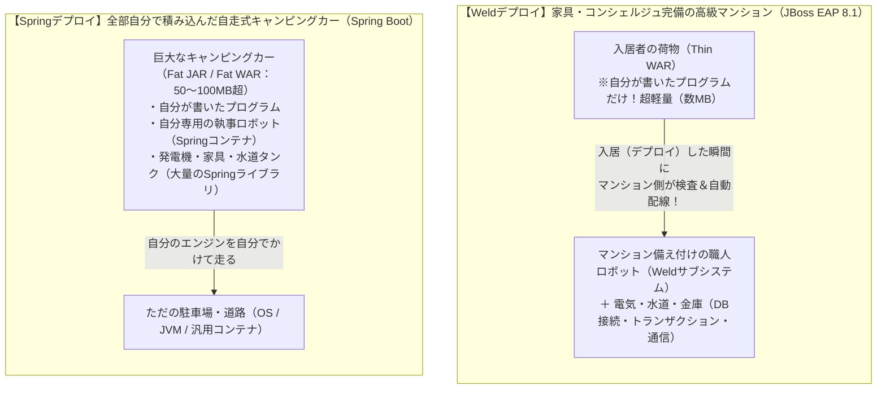
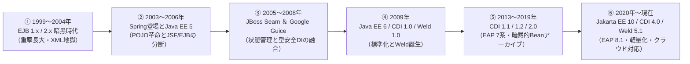
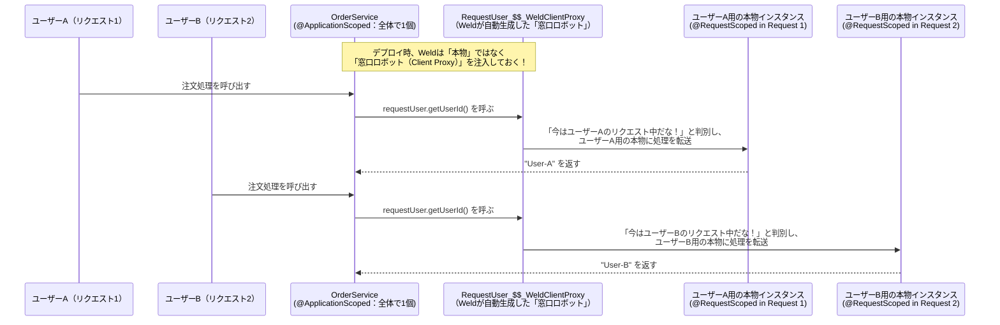
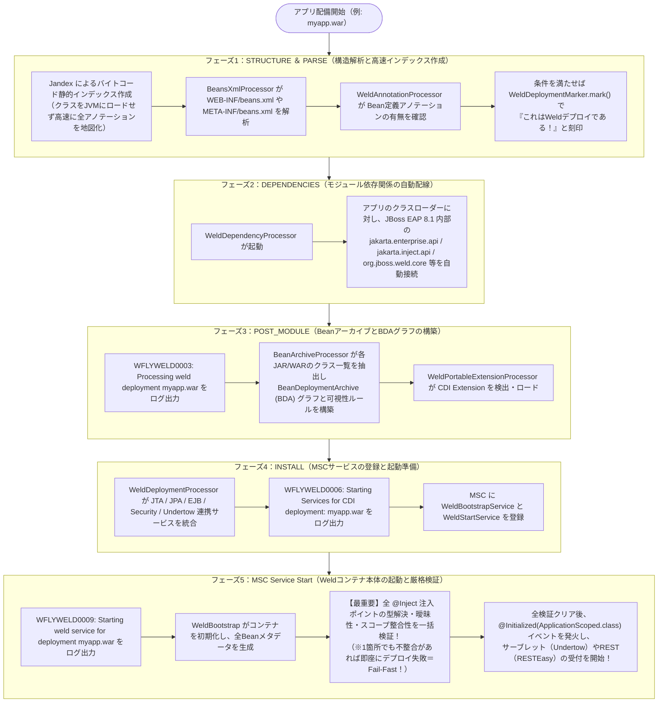
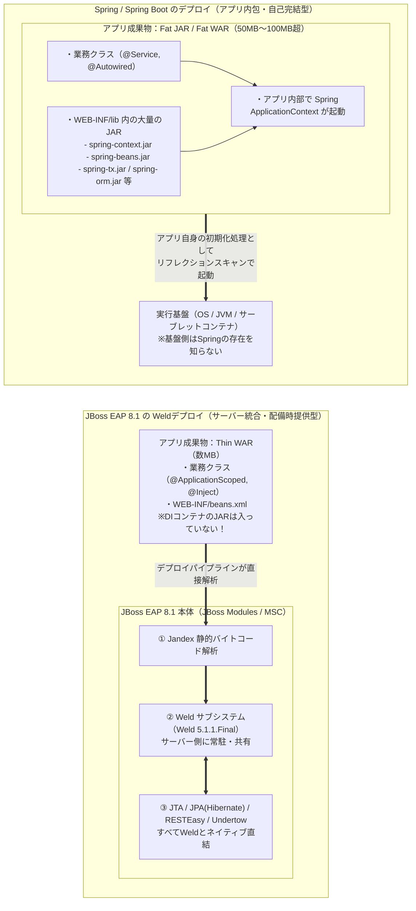

# JBoss EAP 8.1 における「Weldデプロイ」完全解説ガイド
**〜小学生にもわかる基礎のたとえ話から、登場の歴史・CDI 4.0との関係・Springデプロイとの決定的な違い・EAP 8.1内部アーキテクチャまで〜**

---

## 目次

1. [はじめに：小学生にもわかる！3つの魔法のたとえ話](#1-はじめに小学生にもわかる3つの魔法のたとえ話)
2. [Weld（ウェルド）とは何か？](#2-weldウェルドとは何か)
3. [登場の歴史と背景：なぜ CDI と Weld が必要になったのか？](#3-登場の歴史と背景なぜ-cdi-と-weld-が必要になったのか)
4. [CDI と Weld のかかわりあい（仕様と実装・スコープ・プロキシの魔法）](#4-cdi-と-weld-のかかわりあい仕様と実装スコーププロキシの魔法)
5. [どのようなデプロイを「Weldデプロイ」と呼ぶのか？（JBoss EAP 8.1 内部動作）](#5-どのようなデプロイをweldデプロイと呼ぶのかjboss-eap-81-内部動作)
6. [Weldデプロイと Spring（Spring Boot）デプロイの決定的な違い](#6-weldデプロイと-springspring-bootデプロイの決定的な違い)
7. [JBoss EAP 8.1 最新仕様（CDI 4.0 / Weld 5.1）と EAP 7.4 からの移行の勘所](#7-jboss-eap-81-最新仕様cdi-40--weld-51と-eap-74-からの移行の勘所)
8. [実践コード・設定ファイル・JBoss CLI リファレンス](#8-実践コード設定ファイルjboss-cli-リファレンス)
9. [Weldデプロイのトラブルシューティング辞典](#9-weldデプロイのトラブルシューティング辞典)

---

## 1. はじめに：小学生にもわかる！3つの魔法のたとえ話

専門用語に入る前に、まず**「そもそも何をしている仕組みなのか？」**を小学生にもイメージできるように3つのたとえ話で説明します。

### たとえ話①：DI（依存性注入）とは「道具を自動で手渡してくれる魔法」

学校の図工の授業で「工作」をするときを想像してみてください。

* **昔のプログラミング（自分で道具を探しに行く方式）**
  * あなたが紙を切りたいとき、自分で席を立って、学校の倉庫の鍵を開けて、3段目の引き出しから「ハサミ」を探し出して持ってきます。
  * もし学校の倉庫の場所が変わったり、ハサミの種類が「工作用ハサミ」に変わったりしたら、**あなたの動き方（プログラム）を全部書き直さなければなりません**。
* **今のプログラミング：DI（必要な道具を自動で手渡してくれる方式）**
  * あなたは机の上で**「ここにハサミを置いてください（`@Inject`）」というシール**を貼っておくだけです。
  * 授業が始まると、教室にいる**超優秀なロボット（DIコンテナ）**が、あなたの机にぴったりのハサミを自動でポンと置いてくれます。あなたは目の前の工作だけに集中できます。

---

### たとえ話②：「CDI」と「Weld（ウェルド）」の関係は「公式ルールブック」と「溶接職人ロボット」

よく「CDI と Weld は何が違うの？」と疑問に思われます。これは**「ルールブック（設計図）」と「実際に動くロボット」の違い**です。

| 名前 | 小学生向けのたとえ | IT・Javaの世界での意味 |
| :--- | :--- | :--- |
| **CDI**<br>*(Contexts and Dependency Injection)* | **国が決めた「公式ルールブック（設計図）」**<br>「『`@Inject`』というシールが貼ってあったら道具を渡すこと」「使い終わった道具は自動で片付けること」と書かれた**約束事の本**です。本そのものは自分で動きません。 | **Jakarta EE の公式標準仕様（Specification）**<br>Java/Jakarta の世界で「部品同士をどうつなぎ、いつ作っていつ壊すか」を定めた標準規格（JBoss EAP 8.1 では **Jakarta CDI 4.0**）。 |
| **Weld**<br>*(ウェルド＝溶接)* | **ルールブック通りに動く「超一流の溶接職人ロボット」**<br>JBoss EAP というお城の中に住んでいて、ルールブック（CDI）を100%完璧に守りながら、バラバラの部品を**火花を散らしてガッチリ溶接（Weld）して組み立てる実働ロボット**です。 | **CDI の参照実装（Reference Implementation: RI）**<br>Red Hat（旧 JBoss）が中心となって開発した、世界で最も標準的な CDI エンジン（JBoss EAP 8.1 では **Weld 5.1.1.Final** を内蔵）。 |

> **なぜ名前が「Weld（溶接）」なの？**
> 昔のプログラムは、部品と部品をつなぐために大量の設定ファイルという「セロハンテープ（Glue code：糊付けコード）」を人間がペタペタ貼っていました。テープはすぐに剥がれて壊れます。そこで**「テープで貼るのではなく、金属と金属を直接ピタッと強力に溶接（Weld）して、絶対に剥がれない安全な仕組みを作ろう！」**という想いから **Weld** と名付けられました。

---

### たとえ話③：「Weldデプロイ」と「Springデプロイ」の違いは「高級家具付きマンション」と「キャンピングカー」

Java の世界で部品を組み立てる仕組みには、JBoss EAP に内蔵された **Weld（CDI）** と、もう一つ有名な **Spring（スプリング）** があります。この2つの「デプロイ（アプリをサーバーに配置して動かすこと）」の違いは、**「引っ越しのスタイル」**にたとえると一発でわかります。



* **JBoss EAP 8.1 の「Weldデプロイ」（高級家具・コンシェルジュ完備のマンション）**
  * マンション（JBoss EAP 8.1）の中に、最初から超一流の溶接職人ロボット（**Weld**）や水道・電気・警備システムが備え付けられています。
  * あなた（アプリ開発者）は、**小さなリュックサック1個（自分が書いたコードだけの軽い `.war` ファイル）**を持って入居（デプロイ）するだけです。
  * 入居の手続きをした瞬間に、マンションの管理室（JBoss のデプロイ機構）がリュックの中身を検査し、「あ、これは Weld ロボットが必要な荷物だな！」と判定して、備え付けの Weld ロボットが自動で部屋を組み立ててくれます。**この一連の入居・自動組み立てプロセスを「Weldデプロイ」と呼びます。**
* **Spring / Spring Boot のデプロイ（全部積んだ自走式キャンピングカー）**
  * 建物側の設備には頼らず、**「自分専用の執事ロボット（Spring コンテナ）」「発電機」「ベッド」「キッチン」を全部1台の巨大な車（50MB〜100MB以上の Fat JAR / Fat WAR）に積み込んで**引っ越します。
  * どこでも走れる自由さがある反面、荷物がとても重く、車を何台も並べると同じ発電機や執事ロボットが何人もダブってしまいます。

---

## 2. Weld（ウェルド）とは何か？

### 2.1 技術的な定義

**Weld（ウェルド）**とは、Red Hat（JBoss コミュニティ）が開発・主導しているオープンソースプロジェクトであり、**Jakarta Contexts and Dependency Injection（Jakarta CDI）仕様の公式な参照実装（Reference Implementation: RI）**です。

* **公式サイト**: [https://weld.cdi-spec.org/](https://weld.cdi-spec.org/)
* **JBoss EAP 8.1 搭載バージョン**: **`Weld 5.1.1.Final`**（Jakarta EE 10 / **Jakarta CDI 4.0** 完全準拠）
* **JBoss EAP 内のモジュール名**: `org.jboss.as.weld`（サブシステム名：`urn:jboss:domain:weld:5.0`）および `org.jboss.weld.core` / `org.jboss.weld.spi` / `org.jboss.weld.api`

### 2.2 「参照実装（RI）」であることの重大な意味

Java / Jakarta EE の世界では、まず各社やコミュニティのエキスパートが集まって「仕様書（Specification）」を作ります。しかし、紙の仕様書だけでは「本当にその通りにプログラムが作れるのか？」「矛盾はないか？」がわかりません。
そこで、**仕様書と完全に1対1で対応し、仕様の正しさを証明するお手本となる実装（Reference Implementation）**が作られます。

CDI において、初代 CDI 1.0（2009年）から最新の CDI 4.0 / 4.1 に至るまで、**一貫して公式の参照実装（RI）であり続けているのが Weld** です。つまり、**「Weld の挙動こそが Jakarta CDI の世界基準そのもの」**であり、JBoss EAP 8.1 を使うということは、世界で最も純粋かつ実績のある CDI エンジンをネイティブに使うことを意味します。

### 2.3 JBoss EAP 8.1 における Weld の立ち位置

JBoss EAP 8.1 の内部では、さまざまな機能（サブシステム）が動いています。Weld は単なる1つのライブラリではなく、**すべてのサブシステム同士を接着・連携させる「中枢神経（ハブ）」**として動作します。

* **Web層（Undertow / Jakarta Servlet / Jakarta Faces）** で受け取ったリクエストに対し、
* **REST API層（RESTEasy / Jakarta REST）** のリソースクラスにビジネスロジックを注入（`@Inject`）し、
* **トランザクション層（Narayana / Jakarta Transactions）** の `@Transactional` 境界をインターセプターで自動制御し、
* **データアクセス層（Hibernate ORM 6.2 / Jakarta Persistence）** の `EntityManager` や **EJB層（Jakarta Enterprise Beans 4.0）** とシームレスに連携させます。

---

## 3. 登場の歴史と背景：なぜ CDI と Weld が必要になったのか？

「なぜわざわざ CDI や Weld という仕組みが作られたのか？」を知るには、2000年代初頭の Java 開発者たちが味わった**苦難の歴史**を振り返る必要があります。



### 第1期（1999年〜2004年）：EJB 1.x / 2.x の「重厚長大・XML地獄」

初期の Java（J2EE 1.2〜1.4）では、企業のシステムを作るために **EJB（Enterprise JavaBeans）2.x** という規格が使われていました。しかし、これがあまりにも複雑でした。

1. **たった1つの部品を作るのに4つのファイルが必要**：ビジネスロジックを書くクラス以外に、`Home` インターフェース、`Remote/Local` インターフェース、そして巨大な XML 設定ファイル（`ejb-jar.xml`）を人間が手書きする必要がありました。
2. **JNDI ルックアップの手書き地獄**：別の部品を呼び出すたびに、以下のようなおまじない（JNDI 検索コード）を何百箇所も書かなければなりませんでした。
   ```java
   // 昔の J2EE (EJB 2.x) の悪夢のようなコード
   Context ctx = new InitialContext();
   Object ref = ctx.lookup("java:comp/env/ejb/OrderService");
   OrderServiceHome home = (OrderServiceHome) PortableRemoteObject.narrow(ref, OrderServiceHome.class);
   OrderService service = home.create();
   ```
   もし文字列 `"java:comp/env/ejb/OrderService"` を1文字でもタイプミスしていても、**コンパイル時には気づけず、本番やテストで動かした瞬間にエラー（`NamingException`）で爆発**しました。
3. **単体テストが不可能**：APサーバーを起動しないとクラス1個すら動かせない「重厚長大」な構造でした。

### 第2期（2003年〜2006年）：Spring による「POJO革命」と、Java EE 5 に残された「壁」

この EJB 2.x の苦しみに反旗を翻したのが、Rod Johnson 氏らが作った **Spring Framework** と、Gavin King 氏が作った **Hibernate** です。
* **POJO（Plain Old Java Object）の復権**：「特別なインターフェースを継承しない普通の Java クラス（POJO）のまま、外側から DI（依存性注入）で部品をつなごう！」という革命が起きました。
* これを受けて 2006年に登場した **Java EE 5（EJB 3.0）** でも、アノテーション（`@Stateless` や `@EJB`）が導入され、一気に書きやすくなりました。

**【しかし、Java EE 5 には致命的な問題が残っていました！】**
当時の Java EE 5 には、**画面を作る規格（JSF：JavaServer Faces）**と、**裏側の処理を作る規格（EJB 3.0）**がありましたが、この2つは**別々のチームが作った別世界の仕組み**だったのです。
* 画面側（JSF）は `@ManagedBean` という自分のルールで動く。
* 裏側（EJB）は `@Stateless` や `@EJB` という別のルールで動く。
* **「画面の入力ウィザード（確認画面→完了画面）の間だけデータを保持する（対話スコープ）」**といったきめ細かい寿命（コンテキスト）管理ができず、画面と裏側をつなぐために結局人間がドロドロした「つなぎコード」を書く必要がありました。

### 第3期（2005年〜2008年）：直接の親である「JBoss Seam」と「Google Guice」の誕生

ここで、Hibernate の生みの親である **Gavin King 氏（Red Hat / JBoss）** が立ち上がります。
* **JBoss Seam（シーム＝縫い目）の開発**：JSF（画面）と EJB（業務ロジック）と JPA（データベース）の間の「継ぎ目（Seam）」をなくし、**「コンテキスト（部品の寿命：リクエスト、セッション、対話＝Conversation）」**を中心にすべてを統合するフレームワーク **JBoss Seam** を作り、世界中で大ヒットしました。
* **Google Guice（ジュース）の登場**：同じ頃、Google の Bob Lee 氏らが、Spring のような大量の XML 設定ファイルを一切書かず、**Java の型とアノテーション（Qualifier）だけで100%型安全に DI を行う「Google Guice」**を発表しました。

### 第4期（2009年）：Java EE 6 にて「CDI 1.0」と「Weld 1.0」が誕生！

Gavin King 氏は、「JBoss Seam のコンテキスト（寿命）管理の素晴らしさ」と「Google Guice の型安全な DI の素晴らしさ」を合体させ、Java の公式標準規格にすることを提案しました。

1. **JSR-330（Dependency Injection for Java）の統一**：Spring の Rod Johnson 氏、Guice の Bob Lee 氏、JBoss の Gavin King 氏が協力し、Java 共通の注入アノテーション **`@Inject`（`javax.inject.Inject`）** を統一規格として制定しました。
2. **JSR-299（CDI 1.0：Contexts and Dependency Injection）の制定**：その `@Inject` を土台として、Java EE 全体を統合する最強の DI・コンテキスト管理仕様 **CDI 1.0** が 2009年12月（Java EE 6）に誕生しました（策定当初は「Web Beans」と呼ばれていました）。
3. **参照実装「Weld 1.0」の誕生**：Gavin King 氏と Pete Muir 氏（Red Hat）が中心となって開発した CDI の参照実装が **Weld（溶接）** と名付けられ、JBoss AS 6 / **JBoss EAP 6** に標準搭載されました。

### 第5期（2013年〜2019年）：CDI 1.1 / 1.2 / 2.0 への成熟（JBoss EAP 7 時代）

* **CDI 1.1 / 1.2（Java EE 7 / JBoss EAP 7.0）**：それまで必須だった `beans.xml` ファイルがなくても、アノテーション（`@ApplicationScoped` 等）が付いていれば自動的に CDI Bean として認識される**「暗黙的 Bean アーカイブ（Implicit Bean Archive）」**が導入されました。
* **CDI 2.0（Java EE 8 / JBoss EAP 7.2〜7.4 / Weld 3.x）**：非同期イベント通知（`fireAsync()` / `@ObservesAsync`）や、APサーバーなし（Java SE 環境）での Weld 起動が標準化されました。

### 第6期（2020年〜現在）：Jakarta EE 10 ＆ CDI 4.0 ＆ Weld 5.1（JBoss EAP 8.1 時代）

Java EE が Oracle からオープンソース財団 **Eclipse Foundation** へ移管され、名前が **Jakarta EE** に変わりました。
* パッケージ名が `javax.*` から **`jakarta.*`** へ刷新されました（Jakarta EE 9 / 10）。
* クラウドやコンテナ環境で「もっと速く起動し、もっとメモリを節約したい！」という時代要請に応えるため、**Jakarta EE 10（CDI 4.0 / Weld 5.1.1.Final）** では以下の大改革が行われました。
  1. **空の `beans.xml` のデフォルト挙動を `all`（全クラススキャン）から `annotated`（アノテーション付きクラスのみスキャン）へ変更**（起動速度とメモリ効率の劇的向上）。
  2. **CDI Lite（軽量サブセット）と `BuildCompatibleExtension` の策定**：Quarkus（ArC）などのビルド時 DI とも共通化できる次世代拡張仕様の導入。
* そして、この **Jakarta EE 10 / CDI 4.0 / Weld 5.1.1.Final** をフルサポートする最新エンタープライズ基盤が **JBoss EAP 8.1** です。

---

## 4. CDI と Weld のかかわりあい（仕様と実装・スコープ・プロキシの魔法）

### 4.1 なぜ単なる「DI」ではなく「CDI（C + DI）」なのか？

Spring などの一般的な DI コンテナは主に **「DI（Dependency Injection：依存性注入）」** に焦点を当てています。一方、CDI は先頭に **「C（Contexts：コンテキスト＝状況・寿命）」** が付いています。

* **DI（Dependency Injection）**：「**何を（どの部品を）**注入するか」を型安全に解決する仕組み。
* **C（Contexts）**：「その部品が**いつ生まれ、どの範囲で共有され、いつ自動で消滅するか（ライフサイクル）**」を管理する仕組み。

Weld は、この **「C（寿命管理）」と「DI（部品注入）」を一体不可分で制御するエンジン** です。

### 4.2 Weld が管理する 5つの主要スコープ（コンテキスト）

JBoss EAP 8.1 上の Weld は、以下のアノテーションをクラスに付けるだけで、部品の誕生から破棄までを全自動で管理します。

| スコープアノテーション | 種別 | 小学生向けのたとえ | 寿命（いつ作られていつ消えるか） | 主な用途 |
| :--- | :--- | :--- | :--- | :--- |
| **`@RequestScoped`** | Normal Scope | **「1回のお使いメモ」**<br>お使いを頼まれてから帰ってくるまでの間だけ使い、終わったらすぐゴミ箱に捨てるメモ。 | **1回の HTTP リクエストの間だけ生存**。<br>ブラウザからリクエストが来た瞬間に作られ、レスポンスを返した瞬間に Weld が自動破棄する。 | REST API のコントローラ、1リクエスト内の処理状態保持 |
| **`@SessionScoped`** | Normal Scope | **「遊園地の1日パスポート」**<br>あなたが入園してから退園する（ブラウザを閉じる/ログアウトする）まで、あなた専用で持ち歩くパス。 | **1人のユーザーの HTTP セッションの間生存**。<br>複数回のリクエストをまたいで同じユーザーの状態を保持する（`Serializable` 実装が必要）。 | ログイン中のユーザー情報、ショッピングカート |
| **`@ApplicationScoped`** | Normal Scope | **「学校の体育館の大時計」**<br>学校が開いている間ずっと1つだけ存在し、全校生徒みんなが同じ時計を見る。 | **アプリケーション起動中ずっと1つだけ生存（シングルトン）**。<br>全ユーザー・全リクエストで1つのインスタンスを共有する。 | 共通ビジネスロジック、マスタデータキャッシュ、設定管理 |
| **`@ConversationScoped`** | Normal Scope | **「自由研究プロジェクトの箱」**<br>「研究開始（`begin()`）」から「研究発表完了（`end()`）」と宣言するまでの間だけ残しておける箱。 | **開発者が明示的に開始・終了を指定した対話期間中生存**。<br>複数画面遷移（入力→確認→完了）の間だけデータを保持し、完了時に自動破棄する。 | 複数画面にまたがる申込ウィザード |
| **`@Dependent`**<br>*(デフォルト)* | Pseudo Scope<br>*(擬似スコープ)* | **「ノートのページ」**<br>ノート（注入先の親部品）が作られたときに一緒に綴じられ、ノートが捨てられるときに一緒に捨てられる。 | **注入先（親）のオブジェクトと完全に同じ寿命**。<br>どこにも共有されず、注入されるたびに毎回新しいインスタンスが作られる。 | ステートレスなヘルパークラス、小さな部品 |

### 4.3 Weld 最大の魔法：「クライアントプロキシ（Client Proxy）」の仕組み

ここで、システム開発でよく起きる**超重要問題**を考えてみましょう。

> **【問題】**
> アプリ全体で1個しか存在しない長生きの **`@ApplicationScoped`（体育館の大時計）** の中に、1回のアクセスごとに毎回変わる短命の **`@RequestScoped`（A君のお使いメモ、Bさんのお使いメモ）** を `@Inject` で注入したらどうなるでしょうか？
> 普通に実体（本物のオブジェクト）を1回だけ注入してしまうと、**後から来た B さんがアクセスしても、最初に注入された A 君のメモが見えてしまう（データ混入事故！）** はずです。

**Weld はこの問題を「クライアントプロキシ（Client Proxy）」という魔法で、開発者が何も意識しなくても100%安全に解決します。**



* Weld は、Normal Scope（`@RequestScoped`, `@SessionScoped`, `@ApplicationScoped`, `@ConversationScoped`）の部品を注入するとき、本物のオブジェクトを直接渡すのではなく、**バイトコード生成で作った「代理人（Client Proxy：クラス名に `_$$_WeldClientProxy` が付く軽量な窓口）」**を注入します。
* メソッドが呼ばれた瞬間に、この窓口ロボット（Client Proxy）が**「今どの HTTP リクエスト（スレッド）が動いているか？」**を瞬時に調べ、そのリクエスト専用の `@RequestScoped` インスタンスを見つけて呼び出します。
* ※後述しますが、**Spring ではデフォルトがプロキシなしのシングルトン直接注入であるため、同じことをするとスレッド間でデータが混ざるバグになり、明示的に `@Scope(proxyMode = ScopedProxyMode.TARGET_CLASS)` 等を書く必要があります**。Weld ではこれが標準で全自動で行われます。

---

## 5. どのようなデプロイを「Weldデプロイ」と呼ぶのか？（JBoss EAP 8.1 内部動作）

### 5.1 「Weldデプロイ（Weld Deployment）」の厳密な定義

JBoss EAP 8.1 において**「Weldデプロイ」**とは、以下のことを指します。

> **【定義】**
> JBoss EAP 8.1 に配備（デプロイ）されたアプリケーション（`.war`、`.ear`、`.jar`）をサーバー内のデプロイメント・プロセッサが解析した結果、**「このアプリケーション（またはその中のモジュール/ライブラリ）には CDI Bean アーカイブが含まれている」と判定（`WeldDeploymentMarker` を付与）し、そのアプリケーション専用の Weld コンテナサービス（`WeldStartService` 等）を起動して DI・コンテキスト管理を有効化するデプロイ形態**のこと。

逆に言えば、JBoss EAP 8.1 にデプロイされたすべてのアプリが無条件に Weld デプロイになるわけではなく、**「Weld が起動すべき条件（トリガー）」を満たしたデプロイだけが Weld デプロイとして処理されます**。

### 5.2 Weldデプロイと判定される3つのトリガー条件

JBoss EAP 8.1 がアプリケーションの中身を覗き見たとき、以下のいずれか1つでも見つかると「Weldデプロイ」として処理を開始します。

| トリガー番号 | トリガーの種類 | 具体的な条件（JBoss EAP 8.1 / CDI 4.0 基準） |
| :--- | :--- | :--- |
| **条件①** | **明示的 Bean アーカイブ**<br>*(Explicit Bean Archive)* | `WEB-INF/beans.xml`（WARの場合）または `META-INF/beans.xml`（JAR/EJBの場合）が存在し、`bean-discovery-mode` が **`annotated`** または **`all`** に設定されている（`none` 以外）。 |
| **条件②** | **暗黙的 Bean アーカイブ**<br>*(Implicit Bean Archive)* | `beans.xml` が**存在しない**（または CDI 4.0 で**中身が空の `beans.xml`** である）アーカイブのうち、アーカイブ内のクラスに **「Bean 定義アノテーション（Bean Defining Annotations）」** または **EJB セッション Bean アノテーション**が1つ以上付いている。 |
| **条件③** | **CDI 拡張（Extension）の存在** | `META-INF/services/jakarta.enterprise.inject.spi.Extension` または `META-INF/services/jakarta.enterprise.inject.build.compatible.spi.BuildCompatibleExtension` が含まれている。 |

#### 💡 補足：「Bean 定義アノテーション（Bean Defining Annotations）」とは？
`beans.xml` がなくても（あるいは `bean-discovery-mode="annotated"` のときに）、Weld が「あ、これは私が管理すべき CDI の部品だ！」と自動認識する目印のアノテーションです。
* **Normal Scope アノテーション**：`@ApplicationScoped`, `@SessionScoped`, `@RequestScoped`, `@ConversationScoped`
* **擬似スコープ**：`@Dependent`（※注意：`@Singleton` は対象外のため `@ApplicationScoped` を使うのが CDI の鉄則です）
* **インターセプター・デコレーター**：`@Interceptor`, `@Decorator`
* **ステレオタイプ**：`@Model`、または `@Stereotype` が付与されたカスタムアノテーション
* ※**超重要注意点**：クラスに **`@Inject` や `@Named` が書いてあるだけでは Bean 定義アノテーションとはみなされません！** 必ず `@ApplicationScoped` や `@RequestScoped` などのスコープアノテーションをクラスに付ける必要があります。

### 5.3 JBoss EAP 8.1 内部での「Weldデプロイ」5段階パイプライン

JBoss EAP 8.1 は、**MSC（Modular Service Container）** と **DUP（DeploymentUnitProcessor：デプロイメント単位プロセッサ）** という非常に洗練されたパイプラインでアプリをデプロイします。
あなたが `.war` ファイルをデプロイした瞬間、JBoss EAP 8.1 の内部では以下の **5つのフェーズ** がミリ秒単位で順番に実行されます。



### 5.4 サーバーログ（`server.log`）で見る Weldデプロイの証拠

JBoss EAP 8.1 にアプリケーション（例：`sample-app.war`）をデプロイした際、`server.log` に以下のログが出力されれば、それは間違いなく **Weldデプロイ** として認識・起動されています。

```text
INFO  [org.jboss.as.server.deployment] (MSC service thread 1-2) WFLYSRV0027: Starting deployment of "sample-app.war" (runtime-name: "sample-app.war")
INFO  [org.jboss.weld.deployer] (MSC service thread 1-5) WFLYWELD0003: Processing weld deployment sample-app.war
INFO  [org.jboss.weld.Version] (MSC service thread 1-5) WELD-000900: 5.1.1 (Final)
INFO  [org.jboss.weld.deployer] (MSC service thread 1-7) WFLYWELD0006: Starting Services for CDI deployment: sample-app.war
INFO  [org.jboss.weld.deployer] (MSC service thread 1-8) WFLYWELD0009: Starting weld service for deployment sample-app.war
INFO  [org.jboss.as.server] (ServerService Thread Pool -- 45) WFLYSRV0010: Deployed "sample-app.war" (runtime-name : "sample-app.war")
```

| ログメッセージ ID | 出力フェーズ | 小学生向けの意味 | エンジニア向けの内部動作解説 |
| :--- | :--- | :--- | :--- |
| **`WFLYWELD0003`**<br>`Processing weld deployment ...` | `POST_MODULE` | 「おっ、この荷物は Weld ロボットの出番だな！中身を調べるぞ！」 | `WeldDeploymentMarker` が確認され、`BeanArchiveProcessor` 等が Bean アーカイブと Extension の解析を開始した合図。 |
| **`WELD-000900`**<br>`5.1.1 (Final)` | 初回起動時 | 「私は最新型の Weld 5.1.1 ロボットです！」 | JBoss EAP 8.1 に内蔵された Weld エンジンのバージョン出力。 |
| **`WFLYWELD0006`**<br>`Starting Services for CDI deployment: ...` | `INSTALL` | 「水道・電気・金庫と Weld ロボットをつなぐ準備を始めるよ！」 | `WeldDeploymentProcessor` が `WeldBootstrapService` やトランザクション・EJB・JPA 統合サービスを MSC に登録完了した合図。 |
| **`WFLYWELD0009`**<br>`Starting weld service for deployment ...` | MSC Start | 「よし、部品の溶接（組み立て）と安全検査をスタート！」 | `WeldStartService` が実行され、Bean の登録、型安全解決（Type-safe Resolution）、全 `@Inject` ポイントのバリデーションが実行される。 |

---

## 6. Weldデプロイと Spring（Spring Boot）デプロイの決定的な違い

ここが実務のアーキテクチャ選定や移行プロジェクトで最もよく質問される核心ポイントです。
JBoss EAP 8.1 の **Weldデプロイ（Jakarta CDI 4.0）** と、**Spring / Spring Boot のデプロイ** は、単なる「アノテーションの書き方の違い」ではなく、**「誰が・どこで・いつ DI コンテナを動かすか」という根本構造が正反対**です。

### 6.1 構造の違い（アーキテクチャ比較図）



### 6.2 徹底比較マトリクス（全18項目）

| No. | 比較項目 | JBoss EAP 8.1 の Weldデプロイ（Jakarta CDI 4.0） | Spring / Spring Boot のデプロイ |
| :-: | :--- | :--- | :--- |
| **1** | **基本設計思想** | **APサーバー統合型（Server-Managed）**<br>インフラ・ミドルウェア機能はAPサーバー側が一括提供し、アプリは業務ロジックだけに専念する。 | **アプリ内包・自己完結型（App-Bundled）**<br>アプリ自身がDIコンテナや周辺ライブラリをすべて抱え込み、自力で起動する。 |
| **2** | **小学生向けのたとえ** | **高級家具・コンシェルジュ付きのマンション**<br>リュック1つで入居すれば、備え付けの職人ロボット（Weld）が全部配線してくれる。 | **全部積み込んだ自走式キャンピングカー**<br>発電機も執事ロボットも家具も全部自分の車に積んで走る。 |
| **3** | **DIコンテナの実体がある場所** | **JBoss EAP 8.1 サーバー本体側**<br>（`$EAP_HOME/modules/.../org/jboss/weld/...`）に1つだけ存在。 | **アプリケーションのアーカイブ内部**<br>（`WEB-INF/lib/spring-*.jar` または Fat JAR 内）に毎回同梱される。 |
| **4** | **デプロイ成果物のサイズ** | **極めて小さい（Thin WAR：数十KB〜数MB）**<br>ビルドが高速で、ネットワーク転送やデプロイも一瞬で終わる。 | **非常に大きい（Fat WAR / Fat JAR：50MB〜100MB超）**<br>毎回数十個の Spring 関連 JAR をパッケージングして転送する。 |
| **5** | **起動のトリガーと主体** | **APサーバーのデプロイメントパイプライン（MSC）**<br>サーブレットが動き出す**前**に、サーバー自身がデプロイ工程の一部として Weld を起動する。 | **アプリケーション自身の起動コード**<br>`SpringApplication.run()` や `ServletContextListener`（サーブレット初期化時）でアプリ自身が起動する。 |
| **6** | **クラススキャンの仕組み** | **Jandex（静的バイトコードインデックス）**<br>デプロイ時にクラスを JVM にロードせず、高速なバイナリインデックス（Jandex）を作って瞬時に検索する。 | **クラスパス・リフレクションスキャン（またはSpring AOT）**<br>起動時に `WEB-INF/lib` やクラスパスを走査してメタデータを読み込む。 |
| **7** | **依存関係の検証タイミング（Fail-Fast性）** | **デプロイ時に全 `@Inject` を100%一括厳格検証**<br>注入先が見つからない（`WELD-001408`）や複数候補で曖昧（`WELD-001409`）な場合、**必ずデプロイ時点でエラーになり不良アプリの稼働を完全に防ぐ**。 | **Bean生成時に検証（設定により遅延あり）**<br>Singleton Bean は起動時に作られるが、`@Lazy` や動的取得、スコープ設定によっては実行時までエラーに気づかないケースがある。 |
| **8** | **標準規格か独自規格か** | **Jakarta EE 国際標準規格（Jakarta CDI 4.0）**<br>仕様が標準化されており、特定のフレームワーク独自仕様に縛られない。 | **Spring 独自規格（デファクトスタンダード）**<br>一部 `@Inject`（JSR-330）も使えるが、中心は `@Autowired` や `@Configuration` 等の独自仕様。 |
| **9** | **主なアノテーション** | 注入：`@Inject`、特定：`@Qualifier` / `@Named`<br>生成：`@Produces`、破棄：`@Disposes`<br>スコープ：`@ApplicationScoped`, `@RequestScoped` 等 | 注入：`@Autowired`、特定：`@Qualifier`<br>生成：`@Configuration` + `@Bean`<br>定義：`@Component`, `@Service`, `@Repository`, `@Controller` |
| **10** | **【超重要】デフォルトのスコープ** | **`@Dependent`（擬似スコープ）**<br>スコープを省略した場合、注入先の親と寿命を共にする（勝手にシングルトンにならないため状態混入が起きにくい）。 | **`singleton`（シングルトン）**<br>`@Service` や `@Component` を付けるとデフォルトでアプリ全体で1個のインスタンスになる（フィールドに状態を持つと事故になる）。 |
| **11** | **【超重要】長命Beanへの短命Bean注入（Proxy）** | **全自動で Client Proxy が挟まるため完全安全**<br>`@ApplicationScoped` に `@RequestScoped` をそのまま `@Inject` しても、Weld が自動でプロキシを挟みリクエストごとに正しく振り分ける。 | **デフォルトでは直接参照（要注意！）**<br>`Singleton` に `Request` スコープ Bean を注入する際、`proxyMode = ScopedProxyMode.TARGET_CLASS`（または `@RequestScope`）を忘れると起動エラーやデータ混入が起きる。 |
| **12** | **トランザクション連携** | **APサーバーの JTA（Narayana）と完全直結**<br>`@jakarta.transaction.Transactional` を付けるだけで、XA分散トランザクションやEJB・JPAと完全同期する。 | **Spring 独自の `PlatformTransactionManager`**<br>`@org.springframework.transaction.annotation.Transactional` で管理（JTA連携時は追加設定が必要）。 |
| **13** | **複数WARデプロイ時のメモリ効率** | **極めて高い**<br>1つの JBoss EAP 8.1 上に10個の WAR をデプロイしても、Weld や Jakarta EE のクラス群はサーバーの JBoss Modules 上で1つだけ共有される。 | **メモリ消費が大きい**<br>10個の Spring WAR をデプロイすると、10個分の Spring Framework クラス群がそれぞれの WAR のクラスローダーに重複ロードされる。 |
| **14** | **セキュリティパッチ・保守の責任分界点** | **Red Hat の JBoss EAP パッチ適用で一括解決**<br>Weld や RESTEasy、Hibernate に脆弱性が見つかっても、EAP 8.1 にパッチを当てれば全アプリに一括反映される（アプリの再ビルド不要）。 | **アプリ開発チームが全アプリを個別に再ビルド**<br>Spring に脆弱性が見つかると、各アプリの `pom.xml` を書き換えて全 WAR/JAR を再ビルド・再テスト・再デプロイする必要がある。 |
| **15** | **設定ファイル** | `WEB-INF/beans.xml` または `META-INF/beans.xml`<br>（※CDI 4.0ではアノテーションがあればファイル自体も省略可能） | `application.yml` / `application.properties`、JavaConfig（`@Configuration`）、または旧式の `applicationContext.xml` |
| **16** | **イベント駆動の仕組み** | **型安全な `Event<T>` と `@Observes` / `@ObservesAsync`**<br>トランザクション完了時だけ発火させる `@Observes(during = TransactionPhase.AFTER_SUCCESS)` が標準で超強力。 | **`ApplicationEventPublisher` と `@EventListener` / `@TransactionalEventListener`** |
| **17** | **拡張（SPI）の仕組み** | **`Extension`（Portable Extension）** および CDI 4.0 の **`BuildCompatibleExtension`** | **`BeanFactoryPostProcessor`** / **`BeanPostProcessor`** / Spring Boot AutoConfiguration |
| **18** | **得意な領域・ユースケース** | 金融・公共・通信・大企業の基幹システム、長期安定稼働システム、JBoss EAP の統合管理・監視・クラスタリングをフル活用するシステム。 | クラウドネイティブの単体マイクロサービス、Spring Data / Spring Batch / Spring AI など Spring 独自ライブラリ群を大量に使うシステム。 |

---

### 6.3 【実務で超重要】JBoss EAP 8.1 に「Spring Boot の WAR」をデプロイしたときに起きる「二重スキャン問題」と対策

実務では「APサーバーは JBoss EAP 8.1 を使うけれど、アプリの中身は Spring Boot（WAR形式）で作っている」というケースがよくあります。
このとき、**Weldデプロイの仕組みを知らないと大トラブル（デプロイ激重・起動エラー）に遭遇します。**

#### なぜ問題が起きるのか？（原因）
1. あなたが **Spring Boot の Fat WAR（例：中に100個の JAR が入った `spring-app.war`）** を JBoss EAP 8.1 にデプロイします。
2. JBoss EAP 8.1 は「おっ、新しい `.war` が来たぞ！ Weldデプロイかどうか検査しよう！」と、`WEB-INF/lib` の中の100個の JAR を片っ端からスキャンします。
3. すると、Spring が内部で使っているライブラリ（Hibernate Validator や Jackson の拡張モジュール、あるいは Jakarta アノテーションを持つクラス）に反応して、**JBoss EAP 8.1 が「これも Weld デプロイだ！」と勘違いして Weld コンテナを起動してしまいます**。
4. 結果として、**「Spring コンテナ」と「Weld コンテナ」が同じ1つの WAR の中で二重起動**し、デプロイに何分もかかったり、`WELD-001408` エラーで Spring アプリなのに Weld が原因でデプロイに失敗したりします。

#### 解決策：Spring アプリでは `jboss-deployment-structure.xml` で Weld サブシステムを除外する！
Spring / Spring Boot で作った WAR を JBoss EAP 8.1 にデプロイする場合は、アプリの `WEB-INF/jboss-deployment-structure.xml` に以下の設定を1つ置くだけで、**JBoss EAP 8.1 に対して「このアプリは自分の執事（Spring）を連れているから、マンションの Weld ロボットは動かさないでね！」**と伝えることができます。

```xml
<?xml version="1.0" encoding="UTF-8"?>
<jboss-deployment-structure xmlns="urn:jboss:deployment-structure:1.2">
    <deployment>
        <!-- Springアプリのため、JBoss EAP 8.1 の Weld サブシステム（CDI自動起動）を除外する -->
        <exclude-subsystems>
            <subsystem name="weld"/>
        </exclude-subsystems>
    </deployment>
</jboss-deployment-structure>
```

---

## 7. JBoss EAP 8.1 最新仕様（CDI 4.0 / Weld 5.1）と EAP 7.4 からの移行の勘所

### 7.1 JBoss EAP バージョン別の CDI / Weld 進化一覧表

| JBoss EAP バージョン | ベースとなる WildFly | 標準規格バージョン | CDI バージョン | 内蔵 Weld バージョン | パッケージ名前空間 | 空の `beans.xml` のデフォルト挙動 |
| :--- | :--- | :--- | :--- | :--- | :--- | :--- |
| **JBoss EAP 6.4** | JBoss AS 7.5 | Java EE 6 | CDI 1.0 (JSR-299) | Weld 1.1.x | `javax.enterprise.*`<br>`javax.inject.*` | **`all`**（全クラスをBean候補にする） |
| **JBoss EAP 7.0** | WildFly 10 | Java EE 7 | CDI 1.2 (JSR-346) | Weld 2.3.x | `javax.enterprise.*`<br>`javax.inject.*` | **`all`**（全クラスをBean候補にする） |
| **JBoss EAP 7.4** | WildFly 23 | Jakarta EE 8 | CDI 2.0 (JSR-365) | Weld 3.1.x | `javax.enterprise.*`<br>`javax.inject.*` | **`all`**（全クラスをBean候補にする） |
| **JBoss EAP 8.0** | WildFly 28/29 | **Jakarta EE 10** | **Jakarta CDI 4.0** | **Weld 5.1.x** | **`jakarta.enterprise.*`**<br>**`jakarta.inject.*`** | **`annotated`**（※重要な破壊的変更！） |
| **JBoss EAP 8.1**<br>*(最新)* | WildFly 31+ | **Jakarta EE 10** | **Jakarta CDI 4.0** | **Weld 5.1.1.Final** | **`jakarta.enterprise.*`**<br>**`jakarta.inject.*`** | **`annotated`**（※重要な破壊的変更！） |

---

### 7.2 【最重要】JBoss EAP 7.4 から 8.1 への移行で必ずハマる「空の `beans.xml` 問題」

JBoss EAP 7.4 から JBoss EAP 8.1 へアプリケーションを移行する際、`javax` から `jakarta` へのパッケージ名変更の次に必ずぶつかる最大の変更点が、**「中身が空の `beans.xml`（または `bean-discovery-mode` 属性を書いていない `beans.xml`）の扱い」**です。

#### 何が変わったのか？

* **JBoss EAP 7.4 まで（CDI 1.0〜2.0）**
  * `WEB-INF/beans.xml` を中身が空（0バイト、または `<beans></beans>` のみ）で置いておくと、Weld は **`bean-discovery-mode="all"`（明示的 Bean アーカイブ）**として扱いました。
  * つまり、**クラスに `@Dependent` や `@ApplicationScoped` などのアノテーションを1つも付けていないただのクラス（POJO）であっても、自動的にすべて CDI Bean として登録され、`@Inject` で注入できていました**。
* **JBoss EAP 8.0 / 8.1（CDI 4.0 / Weld 5.1）**
  * 巨大なアプリケーションで全クラスを無差別に Bean 化すると、メモリも起動時間も無駄に消費するため、Jakarta CDI 4.0 の仕様変更により、**空の `beans.xml` のデフォルトが `bean-discovery-mode="annotated"` に変更されました！**
  * その結果、**クラスに `@ApplicationScoped` や `@RequestScoped`、`@Dependent` などの「Bean 定義アノテーション」を付けていないクラスは、Weld に無視されるようになり、`@Inject` している箇所で `WELD-001408: Unsatisfied dependencies`（デプロイエラー）が発生します！**

#### `beans.xml` の状態別・挙動比較表（EAP 7.4 vs EAP 8.1）

| `beans.xml` の配置と記述状態 | JBoss EAP 7.4 でのスキャンモード | JBoss EAP 8.1 でのスキャンモード | アノテーションなしクラス（素のPOJO）は `@Inject` できるか？ |
| :--- | :---: | :---: | :--- |
| **`beans.xml` ファイル自体が存在しない** | `annotated` | `annotated` | できない（Bean定義アノテーション付きクラスのみ対象） |
| **中身が空の `beans.xml`（0バイト）**<br>または `bean-discovery-mode` 属性なしの `<beans/>` | **`all`** | **`annotated`**<br>*(★ここが変化！)* | EAP 7.4 では**できた**が、**EAP 8.1 ではできなくなる（エラーになる）！** |
| **`bean-discovery-mode="annotated"` を明記** | `annotated` | `annotated` | できない（Bean定義アノテーション付きクラスのみ対象） |
| **`bean-discovery-mode="all"` を明記** | `all` | `all` | **EAP 8.1 でもできる**（全クラスがBean候補になる） |
| **`bean-discovery-mode="none"` を明記** | `none` | `none` | 一切スキャンされない（そのアーカイブではCDI無効） |

#### 移行時の3つの解決方法

1. **【推奨：王道アプローチ】注入したいクラスに `@Dependent` や `@ApplicationScoped` を明記する**
   * CDI 4.0 のベストプラクティスに従い、CDI Bean として使いたいクラスには必ずスコープアノテーション（`@ApplicationScoped`, `@RequestScoped`, `@Dependent`）を付けます。これにより起動が速くなり、メモリ消費も最小化されます。
2. **【アプリ単位の互換維持】`beans.xml` に `bean-discovery-mode="all"` を明示的に書く**
   * 既存クラスのソースコードを修正できない場合は、`beans.xml` に `bean-discovery-mode="all"` を明記します。
   ```xml
   <?xml version="1.0" encoding="UTF-8"?>
   <beans xmlns="https://jakarta.ee/xml/ns/jakartaee"
          xmlns:xsi="http://www.w3.org/2001/XMLSchema-instance"
          xsi:schemaLocation="https://jakarta.ee/xml/ns/jakartaee https://jakarta.ee/xml/ns/jakartaee/beans_4_0.xsd"
          version="4.0"
          bean-discovery-mode="all">
   </beans>
   ```
3. **【サーバー全体の互換維持】JBoss EAP 8.1 の CLI でレガシー互換フラグを ON にする**
   * JBoss EAP 8.1 の Weld サブシステムには、過去の EAP 7 時代の空 `beans.xml` の挙動（＝`all` 扱い）に戻すための救済設定 `legacy-empty-beans-xml-treatment` が用意されています。
   ```bash
   /subsystem=weld:write-attribute(name=legacy-empty-beans-xml-treatment, value=true)
   reload
   ```

---

### 7.3 CDI 4.0 の新機軸：「CDI Lite」と「CDI Full」

Jakarta CDI 4.0（JBoss EAP 8.1）では、仕様が2つの階層に整理されました。

1. **CDI Lite（軽量コア仕様）**
   * ランタイムの動的リフレクションを減らし、ビルド時にも解析可能なコア機能群（`@Inject`, 主要スコープ, インターセプター, イベント, および新設された **`BuildCompatibleExtension`**）。
   * Quarkus などのクラウドネイティブ・マイクロサービス基盤とコードを共通化できます。
2. **CDI Full（フル機能仕様）**
   * CDI Lite の全機能に加えて、従来の強力な動的機能（`@ConversationScoped`, `@Decorator`, Session Bean 統合, `PassivationCapable`, 従来の **`Extension`（Portable Extension）**）をすべて含む完全版。
   * **JBoss EAP 8.1 の Weld 5.1.1.Final は「CDI Full」と「CDI Lite」の両方を100%完全にサポート**しています。

---

## 8. 実践コード・設定ファイル・JBoss CLI リファレンス

### 8.1 JBoss EAP 8.1 用の標準 `WEB-INF/beans.xml`（CDI 4.0）

```xml
<?xml version="1.0" encoding="UTF-8"?>
<beans xmlns="https://jakarta.ee/xml/ns/jakartaee"
       xmlns:xsi="http://www.w3.org/2001/XMLSchema-instance"
       xsi:schemaLocation="https://jakarta.ee/xml/ns/jakartaee https://jakarta.ee/xml/ns/jakartaee/beans_4_0.xsd"
       version="4.0"
       bean-discovery-mode="annotated">
    <!-- JBoss EAP 8.1 (Jakarta CDI 4.0) 標準設定 -->
</beans>
```

### 8.2 Weld（CDI 4.0）による典型的なアプリケーション実装例

```java
package com.example.order;

import jakarta.enterprise.context.RequestScoped;
import java.time.LocalDateTime;
import java.util.UUID;

/**
 * ① 1回のHTTPリクエストの間だけ生存するBean (@RequestScoped)
 */
@RequestScoped
public class RequestTraceContext {
    private final String traceId = UUID.randomUUID().toString();
    private final LocalDateTime requestedAt = LocalDateTime.now();

    public String getTraceId() {
        return traceId;
    }
    public LocalDateTime getRequestedAt() {
        return requestedAt;
    }
}
```

```java
package com.example.order;

import jakarta.enterprise.context.ApplicationScoped;
import jakarta.inject.Inject;
import jakarta.transaction.Transactional;

/**
 * ② アプリ全体で1つだけ生存するビジネスロジックBean (@ApplicationScoped)
 * 短命な @RequestScoped の RequestTraceContext を直接 @Inject しても、
 * Weld が自動で Client Proxy を挟むため、スレッド安全にリクエストごとの traceId を取得できる！
 */
@ApplicationScoped
public class OrderService {

    @Inject
    private RequestTraceContext traceContext; // Weld Client Proxy が注入される

    @Transactional // JBoss EAP 8.1 の JTA (Narayana) トランザクションと自動連携
    public String processOrder(String itemCode, int quantity) {
        return String.format("[TraceID: %s] 商品 %s を %d 個受注しました（時刻: %s）",
                traceContext.getTraceId(), itemCode, quantity, traceContext.getRequestedAt());
    }
}
```

```java
package com.example.order;

import jakarta.inject.Inject;
import jakarta.ws.rs.GET;
import jakarta.ws.rs.Path;
import jakarta.ws.rs.Produces;
import jakarta.ws.rs.QueryParam;
import jakarta.ws.rs.core.MediaType;

/**
 * ③ Jakarta REST (RESTEasy) エンドポイント
 * JBoss EAP 8.1 では RESTEasy と Weld が完全統合されているためそのまま @Inject 可能
 */
@Path("/orders")
@RequestScoped
public class OrderResource {

    @Inject
    private OrderService orderService;

    @GET
    @Produces(MediaType.TEXT_PLAIN)
    public String createOrder(@QueryParam("item") String item, @QueryParam("qty") int qty) {
        return orderService.processOrder(item, qty);
    }
}
```

### 8.3 JBoss EAP 8.1 の Weld サブシステム管理 CLI コマンド集

JBoss EAP 8.1 の管理 CLI（`jboss-cli.sh` / `jboss-cli.ps1`）で Weld の状態確認やチューニングを行うコマンドです。

```bash
# 1. Weld サブシステムの現在の設定値をすべて確認する
/subsystem=weld:read-resource(include-defaults=true)

# 2. 空の beans.xml を EAP 7.4 以前と同じ「all（全クラス対象）」として扱う（移行救済用）
/subsystem=weld:write-attribute(name=legacy-empty-beans-xml-treatment, value=true)

# 3. 明示的に beans.xml が存在するアーカイブだけをスキャン対象にする（巨大アプリのデプロイ高速化）
/subsystem=weld:write-attribute(name=require-bean-descriptor, value=true)

# 4. 開発診断モード（Weld Probe 等）を有効化する（※本番環境では false にすること）
/subsystem=weld:write-attribute(name=development-mode, value=true)

# 5. Weld デプロイ時のトラブル調査用に TRACE ログを動的に有効化する
/subsystem=logging/logger=org.jboss.weld:add(level=TRACE)
/subsystem=logging/logger=org.jboss.as.weld:add(level=TRACE)
```

---

## 9. Weldデプロイのトラブルシューティング辞典

Weldデプロイで発生するエラーは、**エラーコード（`WELD-xxxxxx`）を見れば原因が100%特定できる**ように設計されています。

| エラーコード / 現象 | エラーメッセージ例 | 小学生向けの説明（なぜ怒られた？） | 技術的な原因（JBoss EAP 8.1） | 具体的な解決策 |
| :--- | :--- | :--- | :--- | :--- |
| **`WELD-001408`** | `Unsatisfied dependencies for type X with qualifiers @Default at injection point ...` | 「『`@Inject` でこの道具をちょうだい』ってシールが貼ってあるけど、**倉庫のどこを探してもその道具が見つからないよ！**」 | ① 注入したいクラスに `@ApplicationScoped` や `@Dependent` 等の Bean 定義アノテーションを付け忘れている。<br>② EAP 8.1 で空の `beans.xml` が `annotated` モードに変わった影響。<br>③ 別モジュール（JAR）に `beans.xml` がない。 | 対象のクラスに `@ApplicationScoped` / `@RequestScoped` / `@Dependent` を付与する。または `beans.xml` の設定を確認する。 |
| **`WELD-001409`** | `Ambiguous dependencies for type X with qualifiers @Default at injection point ...` | 「『ハサミをちょうだい』って言われたけど、**倉庫に『赤いハサミ』と『青いハサミ』の2つがあって、どっちを渡せばいいかわからないよ！**」 | 同じインターフェースを実装した CDI Bean が2つ以上存在し、区別するための `@Qualifier`（限定子）や `@Priority` が指定されていない。 | カスタム `@Qualifier` アノテーションを作って両方（Bean側と `@Inject` 側）に付けるか、片方に `@Alternative` + `@Priority` を設定する。 |
| **`WELD-001414`** | `Bean name is ambiguous. Name X resolves to beans: [...]` | 「同じ『たろうくん（`@Named("taro")`）』という名前の部品が2人いて区別できないよ！」 | `@Named` で指定した EL 名が複数の Bean で重複している。 | `@Named("...")` の名前が一意になるように変更する。 |
| **`WELD-000072`** | `Bean declaring a passivating scope must be passivation capable. Bean: ...` | 「遊園地の1日パス（`@SessionScoped`）は一時保管庫（ファイルや別サーバー）に保存することがあるのに、**保存用のチャック（`Serializable`）が付いていないよ！**」 | `@SessionScoped` または `@ConversationScoped` の Bean（あるいはその中に `@Inject` している `@Dependent` Bean）が `java.io.Serializable` を実装していない。 | 該当クラスに `implements Serializable`（および `serialVersionUID`）を追加する。 |
| **`WELD-001502`**<br>*(または Proxy 生成エラー)* | `Bean type X is not proxyable because it has no non-private no-args constructor` / `is declared final` | 「窓口ロボット（Client Proxy）を作ろうとしたけど、**鍵がかかっていて（引数なしコンストラクタがない / `final` が付いている）身代わりが作れないよ！**」 | Normal Scope（`@ApplicationScoped`, `@RequestScoped` 等）のクラスに引数なしコンストラクタがないか、クラスやメソッドに `final` が付いている。 | `protected` または `public` の引数なしコンストラクタを用意し（コンストラクタ注入を使う場合もダミーの引数なしコンストラクタを用意するか `@Inject` コンストラクタを適切に定義）、`final` を外す。 |
| **`WELD-001303`** | `No active contexts for scope type jakarta.enterprise.context.RequestScoped` | 「今はお客さんからのリクエストが来ていない時間（バックグラウンド処理など）なのに、**リクエスト中しか使えないメモ（`@RequestScoped`）を見ようとしたよ！**」 | HTTP リクエストと無関係な別スレッド（独自生成スレッド等）から `@RequestScoped` や `@SessionScoped` の Bean メソッドを呼び出した。 | バックグラウンド処理で使う Bean は `@ApplicationScoped` にするか、メソッド呼び出し時に `@ActivateRequestContext` アノテーションを付与してリクエストコンテキストを起動する。 |
| **デプロイが極端に遅い / Spring アプリが失敗する** | `WFLYWELD0003` の後、数十秒〜数分間停止する、または Spring 内部クラスで `WELD-001408` が出る | 「Spring の巨大なキャンピングカーの中にある100個の箱を、マンションの Weld ロボットが全部開けて検査しようとしてパンクしているよ！」 | Spring Boot WAR 内の大量の `WEB-INF/lib/*.jar` を Weld がスキャンしてしまっている（二重スキャン問題）。 | `WEB-INF/jboss-deployment-structure.xml` を作成し、`<exclude-subsystems><subsystem name="weld"/></exclude-subsystems>` を記述して Weld を無効化する。 |

---
*作成環境：JBoss EAP 8.1 / Jakarta EE 10 / Jakarta CDI 4.0 / Weld 5.1.1.Final 準拠*
